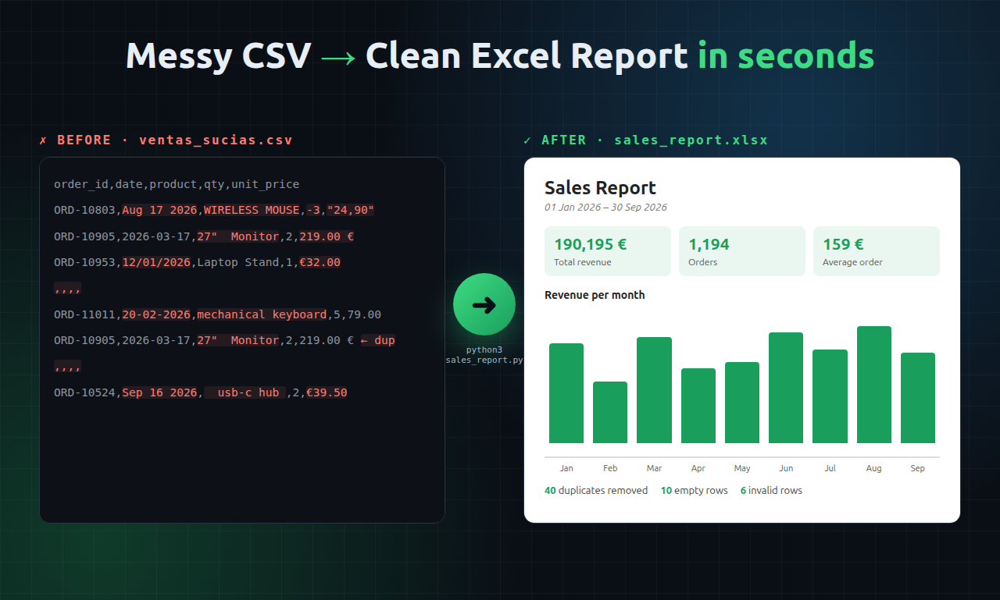

# Sales Report Automation (demo)



Turns a messy sales CSV into a clean, formatted Excel report with KPIs and charts, in seconds.

**What it fixes automatically:** mixed date formats, inconsistent product names, prices with `€` and decimal commas, duplicated rows, empty rows, negative quantities and missing regions or sellers.

**Output (`sales_report.xlsx`):** a Summary sheet (KPIs + cleaning log), Monthly (line chart), By product (bar chart), By seller and Clean data.

## Run it

```bash
python3 -m venv .venv && .venv/bin/pip install pandas openpyxl
.venv/bin/python generate_sample_data.py          # creates fake messy data
.venv/bin/python sales_report.py ventas_sucias.csv
```

Optional email delivery: set `SMTP_USER` and `SMTP_PASSWORD` (a Gmail App Password), then add `--email someone@example.com`.
To run it every Monday at 08:00, use cron: `0 8 * * 1 /path/.venv/bin/python /path/sales_report.py data.csv --email ...`

All data in this demo is fake.
